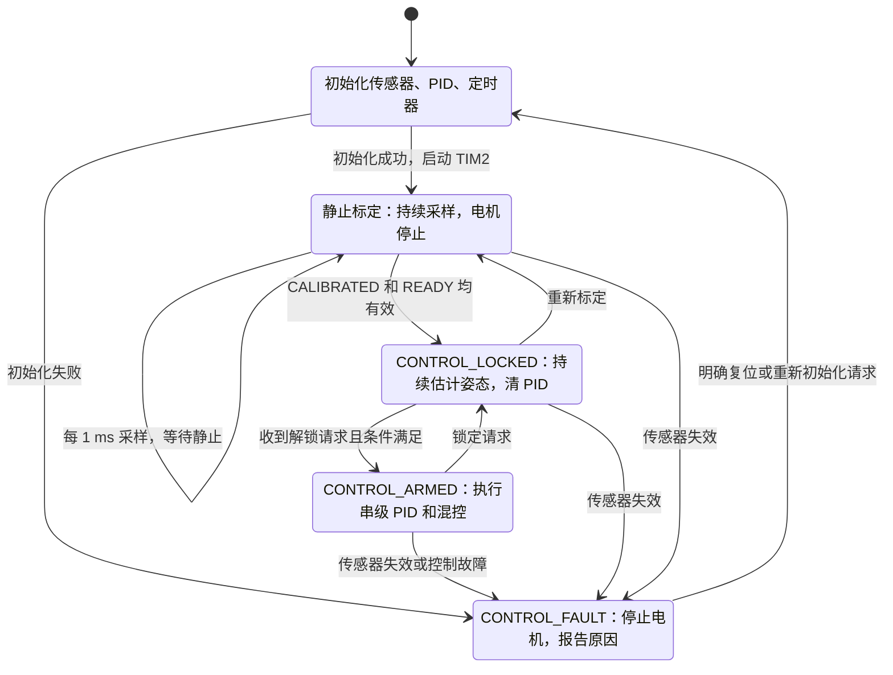
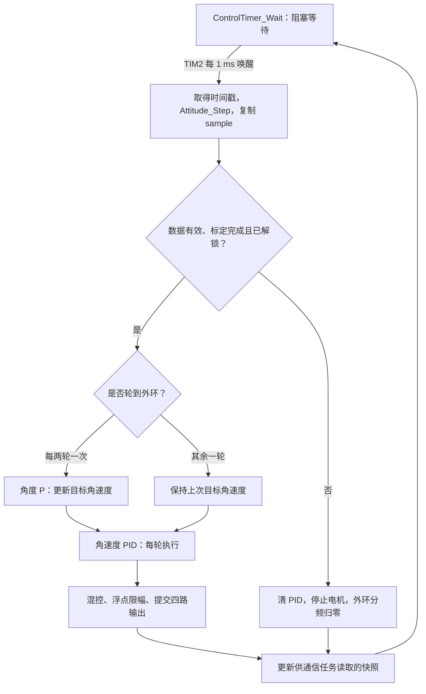

# 500 Hz 外环 / 1 kHz 内环接入说明

本次只实现传感器配置、I2C 和定时器接口；`User/app.c` 中的任务、PID 和混控由你继续编写。Keil 工程已加入 `control_timer.c/.h`，但没有自动启动 TIM2。

## 已实现的接口

- MPU6050：DLPF 开启，采样分频为 0，陀螺仪和加速度计输出 1 kHz。
- `MYI2C`：硬件 I2C1，PB8=SCL、PB9=SDA，400 kHz；MPU/HMC 共用同一个任务拥有的总线。
- `Attitude_Step()`：磁力计每 10 ms 查询一次；融合允许 1 ms 附近的调度抖动。
- 静止标定需要 2000 个样本，在新任务以 1 kHz 调用时约 2 秒。旧任务仍延时 5 ms，未改任务前标定会超过 10 秒。
- `ControlTimer_Init()`：创建内部信号量、配置 TIM2，返回 1 表示成功；不启动计时。
- `ControlTimer_Start()`：在控制任务初始化完成后启动 1 kHz 定时释放，重置统计。
- `ControlTimer_Wait()`：在循环顶部调用，阻塞到下一次释放；返回 1 后执行一轮工作。
- `ControlTimer_Stop()`：同一个控制任务不再需要周期执行时调用。

TIM2 根据实际 APB1 时钟设置预分频。84 MHz 定时器时钟下 PSC=83、ARR=999。中断抢占优先级 6，只清标志、计数、发信号量。

## 控制模式状态机



这里的模式决定“是否控制电机”。所有正常模式都继续采样和姿态解算，标定模式、锁定模式也不能跳过传感器读取。重新进入 ARMED 前清积分、初始化微分历史，令外环分频从第一轮开始。

## 每一轮任务的执行流程



## 建议的任务分工

1. `TaskStart` 完成 BSP 初始化、创建控制和通信任务，然后删除自身。
2. 一个高优先级 `TaskControl` 统一拥有 MPU/HMC 采集、Madgwick、角度环、角速度环和混控。把原 `TaskGY86` 的采集部分和 `TaskMotor` 的控制部分放进这个任务，不再同时运行两个独立采集/控制循环。
3. 一个较低优先级通信任务按 20～50 Hz 发送姿态快照；参数、标定命令通过标志或消息交给控制任务处理。阻塞串口发送不进入控制任务。

控制任务接入骨架如下，其中控制状态与错误处理需要你按上面的图补全；不是可直接替换 `app.c` 的完整实现：

```c
#include "control_timer.h"

/* 初始化阶段：先完成 Attitude_Init()、实际 PID 对象和参数初始化。
 * ControlTimer_Init() 或 Attitude_Init() 失败时进入 FAULT，不启动循环。 */
ControlTimer_Start();
outer_div = 0u;

for (;;) {
    if (!ControlTimer_Wait()) {
        /* 进入故障处理，不能继续计算 PID。 */
        break;
    }
    now_us = Attitude_NowUs();
    Attitude_Step(now_us);
    Attitude_GetData(&sample);

    /* 先处理标定/锁定/故障状态。只有数据有效且已解锁才执行下列部分。 */
    if (outer_div == 0u) {
        angle_loop();
    }
    if (++outer_div >= CONTROL_OUTER_DIVIDER) outer_div = 0u;
    rate_loop();
    mix_and_output();
    /* 发布快照。下一轮回到 Wait()，不要再加 OSTimeDly(1)。 */
}
```

内环 `dt` 使用相邻控制周期的实际间隔，约 0.001 秒。按此统一采集顺序执行时，可使用 `sample.dt`；外环纯 P 不需要乘 `dt`。外环跳过的一轮保留上一轮的目标角速度。

## 调试时观察

在 Watch 中添加 `ControlTimer_Debug`：

- `irq_count`：每秒约增加 1000。
- `wake_count`：接通且工作量满足时，每秒约增加 1000。
- `last_interval_us`：应在 1000 附近。
- `max_work_us`：应小于 1000，并留出余量；包括两次 Wait 之间被其他中断/任务抢占的时间。
- `overrun_count`：理想为 0；说明一轮工作超过 1 ms。
- `coalesced_ticks`：理想为 0；说明仍有未消费的唤醒时又来了定时中断。接口只保留一个待消费唤醒，不连续重放积压的旧周期。
- `post_errors`：应为 0。

任务未接入前这些计数保持 0 是正常的。增加你自己的外环计数器，每秒应约增加 500。

TIM2 定时与 MPU 内部采样时钟并不同步；若需要严格对齐每个新样本，可进一步使用 MPU DATA_RDY 状态或 INT 中断同步。先实际测量执行耗时和数据更新，再判断能否稳定达到目标频率。

目前 ESC 输出仍为 50 Hz。PID 计算 1 kHz 并不代表电调刷新 1 kHz。更高电调刷新率要按电调支持的协议单独调整。上次检查指出的 PID 指针、限幅、积分、微分、混控错误仍需先修好，再进入 ARMED。
